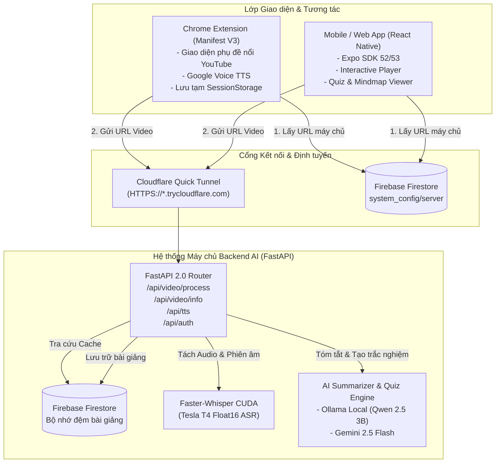

# 🎓 HỆ THỐNG TỰ ĐỘNG TÓM TẮT & ĐỒNG BỘ PHỤ ĐỀ ĐA NGÔN NGỮ CHO VIDEO BÀI GIẢNG
### (AI Lecture Subtitle, Translation & Smart Summary Ecosystem)

[](https://fastapi.tiangolo.com/)
[](https://reactnative.dev/)
[](https://github.com/SYSTRAN/faster-whisper)
[](https://ai.google.dev/)
[](https://ollama.com/)
[](https://firebase.google.com/)
[](https://opensource.org/licenses/MIT)

> **Học phần:** Phát triển Ứng dụng  
> **Trường:** Đại học Lạc Hồng (LHU) - Khoa Công nghệ Thông tin  
> **Giảng viên hướng dẫn:** ThS. Phan Mạnh Thường  
> **Nhóm sinh viên thực hiện:**
> 1. **Võ Trần Minh Thắng** (MSSV: `123001472` - Nhóm trưởng)  
> 2. **Vũ Đình Khánh Long** (MSSV: `123001217` - Thành viên)  

---

## 📑 MỤC LỤC
1. [Giới thiệu Dự án](#-giới-thiệu-dự-án)
2. [Tính năng Nổi bật](#-tính-năng-nổi-bật)
3. [Kiến trúc Hệ thống Toàn diện](#-kiến-trúc-hệ-thống-toàn-diện)
4. [Cấu trúc Thư mục Dự án](#-cấu-trúc-thư-mục-dự-án)
5. [Yêu cầu Môi trường](#-yêu-cầu-môi-trường)
6. [Hướng dẫn Khởi chạy Chi tiết](#-hướng-dẫn-khởi-chạy-chi-tiết)
   - [Cách 1: Khởi chạy Máy chủ AI trên Google Colab GPU T4 (Khuyến nghị)](#cách-1-chạy-máy-chủ-ai-trên-google-colab-gpu-tesla-t4-khuyến-nghị-100)
   - [Cách 2: Khởi chạy Máy chủ Localhost](#cách-2-chạy-máy-chủ-backend-cục-bộ-localhost)
   - [Cài đặt Tiện ích Trình duyệt (Browser Extension)](#cài-đặt-tiện-ích-mở-rộng-trình-duyệt-browser-extension)
   - [Khởi chạy Mobile App & Web App (React Native - Expo)](#khởi-chạy-mobile-app--web-app-react-native---expo)
7. [Hướng dẫn Sử dụng Chi tiết](#-hướng-dẫn-sử-dụng-chi-tiết)
8. [Tài liệu API Endpoints](#-tài-liệu-api-endpoints)
9. [Bảo mật & Bản quyền](#-bảo-mật--quyền-riêng-tư)
10. [Giấy phép (License)](#-giấy-phép-license)

---

## 📖 GIỚI THIỆU DỰ ÁN

Trong kỷ nguyên số hóa giáo dục, các nền tảng video học tập trực tuyến (đặc biệt là YouTube, Coursera, MIT OpenCourseWare) sở hữu nguồn tri thức khổng lồ. Tuy nhiên, người học thường xuyên đối mặt với 3 thách thức lớn:
* **Rào cản ngôn ngữ:** Phần lớn bài giảng quốc tế chuyên sâu sử dụng tiếng Anh hoặc thiếu phụ đề chuẩn xác.
* **Tốn thời gian:** Bài giảng kéo dài 45–90 phút, khó nắm bắt dàn ý và các công thức/thuật ngữ quan trọng.
* **Thiếu tương tác ôn tập:** Không có hệ thống câu hỏi kiểm tra củng cố kiến thức ngay sau khi xem video.

**Hệ thống AI Lecture Subtitle, Translation & Smart Summary** được nghiên cứu và phát triển để giải quyết triệt để các vấn đề trên thông qua hệ sinh thái 3 nền tảng tích hợp:
1. **Máy chủ AI (Backend AI):** Xử lý nhận dạng giọng nói tốc độ cao trên GPU với mô hình Whisper, dịch thuật đồng bộ timestamps và tóm tắt thông minh qua Gemini 2.5 Flash / Ollama Local.
2. **Tiện ích Chrome (Browser Extension Manifest V3):** Hiển thị khung phụ đề song ngữ Glassmorphism trực tiếp trên trình phát video YouTube, tích hợp phát âm chuẩn giọng bản ngữ Google Translate (Chị Google).
3. **Ứng dụng Di động & Web (React Native - Expo):** Cung cấp không gian học tập di động, tra cứu sơ đồ tư duy (Mindmap), làm bài tập trắc nghiệm và đồng bộ đám mây đa thiết bị.

---

## ✨ TÍNH NĂNG NỔI BẬT

### 🎙️ 1. Bóc tách giọng nói (ASR) & Đồng bộ Phụ đề Song ngữ
* **Nhận diện chính xác từng giây:** Ứng dụng mô hình `faster-whisper` (hỗ trợ CUDA float16), tự động lọc khoảng lặng (`vad_filter`) và bóc tách câu chữ chuẩn xác.
* **Chống lặp câu & ảo giác:** Tích hợp `condition_on_previous_text=False` và `initial_prompt` theo ngữ cảnh bài giảng tiếng Việt.
* **Hiển thị song ngữ (Bilingual):** Dòng dịch chính hiển thị to rõ phía trên, dòng gốc tiếng Anh/Việt hiển thị mờ phía dưới.

### 🔊 2. Phát âm chuẩn giọng bản ngữ Google Translate (Voice TTS)
* **Chuẩn giọng Google 100%:** Phát âm tiếng Việt chuẩn có dấu, ngữ điệu tự nhiên (giọng chị Google quen thuộc) hoặc tiếng Anh, Nhật, Hàn, Trung bản ngữ.
* **Tương tác trực quan:** Nhấp đúp chuột vào từ hoặc kéo bôi đen cụm từ trên khung phụ đề để nghe phát âm ngay tức thì.
* **Cơ chế dự phòng kép:** Gọi qua Backend AI proxy hoặc phát trực tiếp từ luồng âm thanh Google Translate, loại bỏ hoàn toàn lỗi mạng.

### 📝 3. Tóm tắt 4 phần & Sinh câu hỏi ôn tập (AI Quiz)
* **Bản tóm tắt chuyên sâu:** Đầy đủ 4 cấu phần:
  1. *Tóm tắt tổng quan bài giảng* (Executive Summary).
  2. *Các luận điểm then chốt* (Key Points).
  3. *Thuật ngữ chuyên ngành & công thức* (Formulas & Terms).
  4. *Sơ đồ phân cấp tư duy* (Mindmap).
* **Ngân hàng trắc nghiệm tự động:** Tạo các câu hỏi 4 lựa chọn (A, B, C, D) kèm mốc thời gian xuất hiện trong video và giải thích đáp án chi tiết.

### ⚡ 4. Bộ nhớ đệm Đám mây Đa tầng (0.01s Instant Cache)
* Lưu trữ vĩnh viễn dữ liệu bài giảng vào Google Cloud Firestore.
* Khi người dùng xem lại bài giảng cũ, hệ thống trả kết quả ngay trong **0,01 giây**, **tiết kiệm 100% token Gemini và tài nguyên GPU**.

### 📱 5. Tự động đồng bộ hóa toàn diện (Zero-Config Sync)
* Máy chủ Colab sau khi bật sẽ tự động đẩy URL đường hầm Cloudflare lên Firestore.
* Cả **Ứng dụng Di động** và **Tiện ích Chrome** đều tự động phát hiện đường dẫn máy chủ mới nhất mà người dùng **không cần nhập tay URL**.

---

## 🏛️ KIẾN TRÚC HỆ THỐNG TOÀN DIỆN



---

## 📂 CẤU TRÚC THƯ MỤC DỰ ÁN

```text
Phát triển ứng dụng/
├── backend-ai/                      # MÃ NGUỒN MÁY CHỦ BACKEND AI (FASTAPI)
│   ├── app/
│   │   ├── api/
│   │   │   └── websocket_router.py  # WebSocket bóc tách trực tiếp (Live Caption)
│   │   ├── core/
│   │   │   ├── config.py            # Cấu hình biến môi trường pydantic-settings
│   │   │   └── dependencies.py      # Middleware xác thực JWT & Rate Limit
│   │   ├── models/
│   │   │   └── schemas.py           # Pydantic schemas (Request/Response models)
│   │   ├── routers/
│   │   │   ├── auth.py              # Đăng ký, đăng nhập, cấp token & quên mật khẩu OTP
│   │   │   ├── history.py           # Lịch sử bài giảng người dùng
│   │   │   └── video.py             # Xử lý video, tải âm thanh, TTS, burn phụ đề
│   │   ├── services/
│   │   │   ├── audio_service.py     # yt-dlp & FFmpeg trích xuất âm thanh
│   │   │   ├── auth_service.py      # Băm Bcrypt & mã hóa JWT an toàn
│   │   │   ├── email_service.py     # Gửi mã OTP xác minh qua Email
│   │   │   ├── subtitle_exporter.py # Xuất định dạng SRT, VTT, TXT
│   │   │   ├── subtitle_parser.py   # Phân tích file phụ đề tải lên
│   │   │   ├── summary_service.py   # Pipeline tóm tắt & Quiz qua Gemini / Ollama
│   │   │   ├── translation_service.py# Dịch thuật song ngữ đa ngôn ngữ
│   │   │   └── whisper_service.py   # Nhận diện giọng nói Faster-Whisper CUDA
│   │   ├── firebase_database.py     # Kết nối Cloud Firestore & Quản lý Cache
│   │   └── main.py                  # Khởi tạo FastAPI App & Middleware CORS
│   ├── requirements.txt             # Thư viện Python dependencies
│   ├── run_server.py                # File khởi chạy máy chủ cục bộ (Localhost)
│   └── serviceAccountKey.json       # Khóa cấu hình dịch vụ Firebase Admin SDK
│
├── browser-extension/               # TIỆN ÍCH MỞ RỘNG TRÌNH DUYỆT (MANIFEST V3)
│   ├── manifest.json                # Khai báo quyền, host permissions & scripts
│   ├── popup.html / popup.css       # Giao diện điều khiển nhanh khi click icon
│   ├── popup.js                     # Điều hướng, gọi API, auto-load bài giảng cũ
│   ├── content.js                   # Tiêm khung phụ đề nổi, TTS & auto-sync YouTube
│   └── overlay.css                  # Hiệu ứng Glassmorphism, ghim khung lên video
│
├── mobile-app/                      # ỨNG DỤNG DI ĐỘNG & WEB (REACT NATIVE / EXPO)
│   ├── src/
│   │   ├── screens/
│   │   │   ├── HomeScreen.js        # Màn hình chính phát video, phụ đề, Quiz
│   │   │   ├── ProfileScreen.js     # Màn hình hồ sơ, cấp bậc EXP, đăng nhập/OTP
│   │   │   └── SettingsScreen.js    # Cài đặt thư mục, backup dữ liệu, bảo mật
│   │   ├── components/              # Các component giao diện tái sử dụng
│   │   ├── constants/theme.js       # Hệ màu Dark Theme hiện đại
│   │   └── services/api.js          # Client gọi API, tự động đồng bộ link máy chủ
│   ├── package.json                 # Cấu hình thư viện Expo SDK 52/53
│   └── App.js                       # Điểm khởi đầu ứng dụng & Bottom Tabs
│
├── PTUD.ipynb                       # NOTEBOOK CHẠY TOÀN BỘ BACKEND TRÊN GOOGLE COLAB GPU
├── backend_ai_colab.ipynb           # Notebook dự phòng tối ưu hóa Tesla T4
└── docs/                            # TÀI LIỆU HỌC THUẬT & HƯỚNG DẪN DỰ ÁN
    └── QUY_TRINH_KHOI_DONG_LAI_COLAB.md # Quy trình khởi động lại Colab từng bước
```

---

## 🛠️ YÊU CẦU MÔI TRƯỜNG

Trước khi cài đặt, hãy đảm bảo máy tính đã cài đặt các công cụ sau:
* **Node.js:** Phiên bản `18.x` hoặc `20.x` LTS ([nodejs.org](https://nodejs.org/))
* **Python:** Phiên bản `3.10` hoặc `3.11` ([python.org](https://www.python.org/))
* **FFmpeg:** Cần thiết cho xử lý âm thanh video ([ffmpeg.org](https://ffmpeg.org/download.html) hoặc cài qua lệnh `winget install Gyan.FFmpeg` trên Windows)
* **Trình duyệt Web:** Google Chrome, Microsoft Edge, Brave hoặc Cốc Cốc.
* **Tài khoản Google Colab:** Dùng để chạy máy chủ Backend AI miễn phí trên card GPU Tesla T4.

---

## 🚀 HƯỚNG DẪN KHỞI CHẠY CHI TIẾT

### CÁCH 1: CHẠY MÁY CHỦ AI TRÊN GOOGLE COLAB GPU TESLA T4 (KHUYẾN NGHỊ 100%)
*Tận dụng card đồ họa Tesla T4 16GB VRAM của Google để bóc tách video siêu tốc, không tốn tài nguyên máy tính cá nhân.*

1. Truy cập [Google Colab](https://colab.research.google.com/) và tải file notebook **`PTUD.ipynb`** lên.
2. Kiểm tra loại phần cứng GPU:  
   * Vào menu **Thời gian chạy (Runtime)** $\rightarrow$ **Thay đổi loại thời gian chạy (Change runtime type)**.  
   * Chọn **T4 GPU** $\rightarrow$ Bấm **Lưu**.
3. Nạp file cấu hình Firebase:  
   * Bấm biểu tượng thư mục 📁 ở cột bên trái Colab.  
   * Kéo thả file **`serviceAccountKey.json`** vào thư mục `/content`.
4. Bấm menu **Thời gian chạy (Runtime)** $\rightarrow$ **Chạy tất cả (Run all)** (hoặc phím tắt `Ctrl + F9`).
5. Đợi Ô số 3 hoàn tất, hệ thống sẽ in ra đường link công khai dạng:
   ```text
   🎉 ĐƯỜNG LINK BACKEND CỦA BẠN LÀ:
   👉 https://xxxx-xxxx-xxxx.trycloudflare.com
   ```
   *(Đường dẫn này được tự động cập nhật lên Firebase Firestore, Tiện ích Chrome và Mobile App sẽ tự động kết nối mà không cần cấu hình thêm).*

---

### CÁCH 2: CHẠY MÁY CHỦ BACKEND CỤC BỘ (LOCALHOST)

1. **Mở terminal chuyển vào thư mục backend:**
   ```powershell
   cd "backend-ai"
   ```
2. **Khởi tạo và kích hoạt môi trường ảo Python:**
   ```powershell
   python -m venv .venv
   .\.venv\Scripts\activate
   ```
3. **Cài đặt các gói thư viện cần thiết:**
   ```powershell
   pip install -r requirements.txt
   ```
4. **Tạo file cấu hình `.env`:**
   ```env
   PORT=8000
   WHISPER_DEVICE=cpu
   WHISPER_COMPUTE_TYPE=int8
   WHISPER_MODEL_SIZE=base
   GEMINI_API_KEY=your_gemini_api_key_here
   JWT_SECRET_KEY=super_secret_jwt_key_ptud_dt012
   FIREBASE_CREDENTIALS_PATH=serviceAccountKey.json
   ```
5. **Khởi chạy máy chủ:**
   ```powershell
   python run_server.py
   ```
   * Swagger Docs kiểm tra API: **`http://127.0.0.1:8000/docs`**

---

### CÀI ĐẶT TIỆN ÍCH MỞ RỘNG TRÌNH DUYỆT (BROWSER EXTENSION)

1. Mở trình duyệt Chrome / Edge, truy cập: `chrome://extensions/`
2. Bật công tắc **Chế độ dành cho nhà phát triển (Developer mode)** ở góc trên bên phải.
3. Bấm nút **Tải tiện ích đã giải nén (Load unpacked)** ở góc trên bên trái.
4. Chọn đường dẫn đến thư mục:  
   `c:\...\Phát triển ứng dụng\browser-extension`
5. Tiện ích **"PHỤ ĐỀ BÀI GIẢNG TỰ ĐỘNG"** sẽ xuất hiện trên thanh công cụ trình duyệt. Bấm biểu tượng 📌 để ghim tiện ích.

---

### KHỞI CHẠY MOBILE APP & WEB APP (REACT NATIVE - EXPO)

1. **Mở terminal chuyển vào thư mục `mobile-app`:**
   ```powershell
   cd "mobile-app"
   ```
2. **Cài đặt thư viện dependencies:**
   ```powershell
   npm install
   ```
3. **Khởi chạy ứng dụng:**
   * **Chạy trên Trình duyệt Web (Nhanh & Tiện lợi):**
     ```powershell
     npm run web
     ```
     Trình duyệt sẽ tự động mở trang web tại địa chỉ: `http://localhost:8081`
   * **Chạy trên Điện thoại Android / iOS:**
     ```powershell
     npm start
     ```
     Mở ứng dụng **Expo Go** trên điện thoại, quét mã QR hiển thị trên màn hình terminal để chạy ứng dụng trực tiếp trên thiết bị di động.

---

## 📱 HƯỚNG DẪN SỬ DỤNG CHI TIẾT

### 1. Trải nghiệm trên YouTube với Browser Extension
1. Mở video bài giảng bất kỳ trên YouTube (ví dụ: `https://www.youtube.com/watch?v=Grr2fedvm00`).
2. Bấm vào biểu tượng tiện ích trên thanh công cụ:
   * Nếu bài giảng đã được xử lý trước đó, tiện ích sẽ **tự động nạp phụ đề chỉ trong 1-2 giây**.
   * Nếu là video mới, bấm **⚡ Bắt đầu tạo phụ đề** để máy chủ AI tiến hành bóc tách.
3. **Xem phụ đề song ngữ trực tiếp:** Khung phụ đề nổi Glassmorphism sẽ hiển thị ngay phía trên thanh điều khiển của video YouTube.
4. **Phát âm từ vựng chuẩn giọng Google:** Bôi đen bất kỳ từ hoặc câu nào trên khung phụ đề để nghe giọng chị Google đọc chuẩn xác.
5. **Xem Tóm tắt & Trắc nghiệm:** Chuyển qua các tab **Tóm tắt** và **Trắc nghiệm** ngay trong popup để ôn tập kiến thức cốt lõi.

### 2. Trải nghiệm trên Ứng dụng Di động & Web (Mobile App)
* **Tab Bài giảng:** Dán link YouTube để xem video, theo dõi phụ đề cuộn đồng bộ theo thời gian thực (nhấp vào dòng phụ đề bất kỳ để tua video tới mốc thời gian tương ứng).
* **Tab Tóm tắt & Mindmap:** Đọc các ý chính tóm lược và sơ đồ cây phân cấp tri thức bài học.
* **Tab Trắc nghiệm:** Làm bài tập trắc nghiệm củng cố kiến thức, nhận điểm số và giải thích đáp án ngay lập tức.
* **Tab Hồ sơ:** Theo dõi cấp bậc học viên, tích lũy điểm kinh nghiệm (EXP) và quản lý tài khoản cá nhân.

---

## 🔌 TÀI LIỆU API ENDPOINTS

| Phương thức | Endpoint | Mô tả chức năng | Quyền truy cập |
| :--- | :--- | :--- | :--- |
| `GET` | `/` | Kiểm tra tình trạng hoạt động của Máy chủ AI | Public |
| `POST` | `/api/auth/register` | Đăng ký tài khoản học viên mới | Public |
| `POST` | `/api/auth/login` | Đăng nhập hệ thống, cấp mã JWT Token | Public |
| `POST` | `/api/auth/forgot-password` | Gửi mã OTP khôi phục mật khẩu qua Email | Public |
| `POST` | `/api/auth/reset-password` | Xác thực mã OTP và đặt lại mật khẩu mới | Public |
| `GET` | `/api/video/info` | Tra cứu nhanh thời lượng & kiểm tra bài giảng trong Cache | Bearer Token |
| `POST` | `/api/video/process` | Bóc tách âm thanh, Whisper ASR, dịch thuật và tóm tắt | Bearer Token |
| `POST` | `/api/video/lookahead` | Tải phụ đề trước 15s cho video dài (Streaming) | Public / Token |
| `POST` | `/api/video/cancel/{job_id}`| Hủy tiến trình xử lý đang chạy ngầm | Bearer Token |
| `GET` | `/api/tts` | Phát âm chuẩn Google Translate TTS đa ngôn ngữ | Public / Optional |
| `GET` | `/api/history` | Lấy danh sách bài giảng đã học theo tài khoản | Bearer Token |
| `POST` | `/api/subtitles/process` | Dịch & tạo trắc nghiệm từ file phụ đề tải lên (.srt, .vtt) | Bearer Token |
| `POST` | `/api/video/burn-subtitles`| Nhúng (burn) phụ đề cứng trực tiếp vào video qua FFmpeg | Bearer Token |

---

## 🔒 BẢO MẬT & QUYỀN RIÊNG TƯ

1. **Bảo mật danh tính & Mật khẩu:** Toàn bộ mật khẩu được mã hóa băm một chiều an toàn bằng thuật toán **Bcrypt**. Phiên làm việc duy trì qua **JSON Web Token (JWT)** có thời hạn.
2. **Xác thực bảo vệ bằng mã OTP:** Quy trình khôi phục tài khoản sử dụng mã xác thực 6 chữ số ngẫu nhiên được gửi trực tiếp vào hòm thư cá nhân.
3. **Quyền riêng tư dữ liệu:** Dữ liệu phụ đề và ghi chú cá nhân của từng học viên được phân tách độc lập theo `owner_id` trên Google Cloud Firestore.
4. **Bản quyền phương tiện:** Hệ thống tôn trọng quyền sở hữu trí tuệ của tác giả video; toàn bộ quá trình trích xuất âm thanh và bóc tách nội dung phục vụ thuần túy cho mục đích nghiên cứu học thuật phi thương mại.

---

## 📄 GIẤY PHÉP (LICENSE)

Dự án được phân phối dưới giấy phép mã nguồn mở **[MIT License](LICENSE)**. Toàn bộ mã nguồn phục vụ mục đích nghiên cứu, học tập và phát triển ứng dụng tại **Trường Đại học Lạc Hồng (LHU)**.
