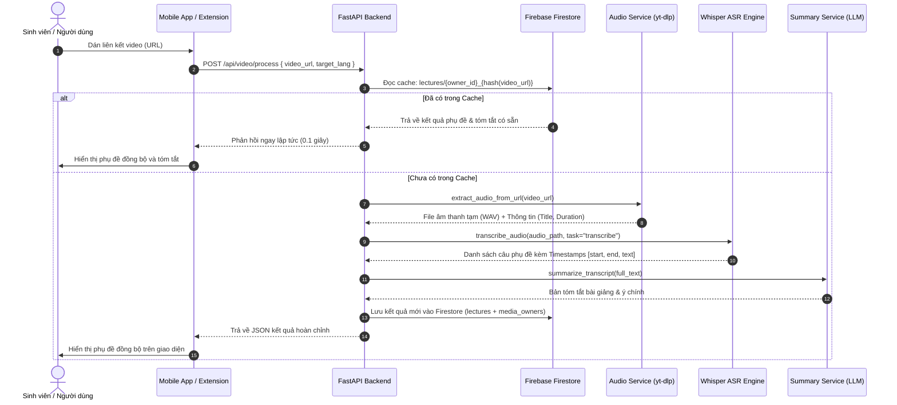
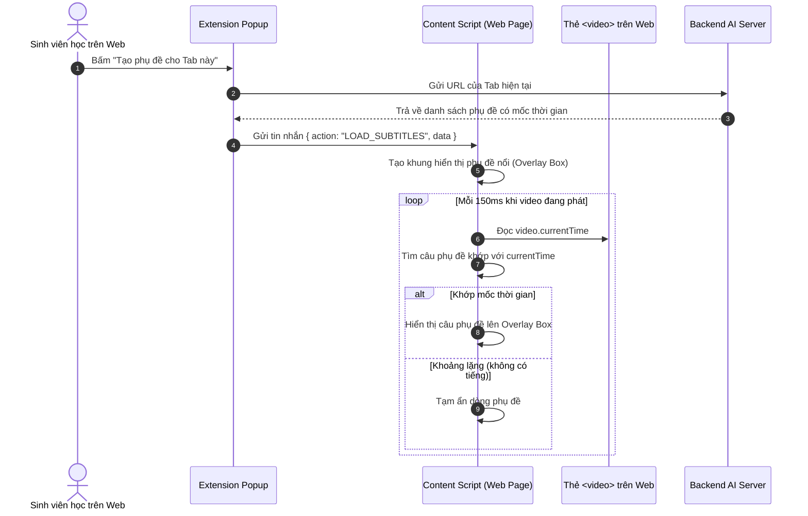

# TÀI LIỆU THIẾT KẾ KIẾN TRÚC HỆ THỐNG & CƠ SỞ DỮ LIỆU
## Học phần: Phát triển Ứng dụng | Đại học Lạc Hồng

> **Đề tài:** Ứng dụng tự động tóm tắt và đồng bộ phụ đề đa ngôn ngữ cho video bài giảng  
> **Sinh viên thực hiện:** Võ Trần Minh Thắng & Vũ Đình Khánh Long  
> **Giáo viên hướng dẫn:** ThS. Phan Mạnh Thường  

---

## 1. KIẾN TRÚC PHÂN TẦNG (LAYERED ARCHITECTURE)

Hệ thống được thiết kế theo mô hình kiến trúc phân tầng chuẩn công nghiệp, đảm bảo tính mở rộng và dễ bảo trì:

```
┌────────────────────────────────────────────────────────────────────────────┐
│ 1. TẦNG TRÌNH DIỄN (PRESENTATION LAYER - CLIENTS)                          │
│    - Mobile App: React Native (Cross-platform Android / iOS)               │
│    - Browser Extension: Chrome Extension Manifest V3 (Content Script, UI)  │
└─────────────────────────────────────┬──────────────────────────────────────┘
                                      │ HTTP REST API / WebSocket
┌─────────────────────────────────────▼──────────────────────────────────────┐
│ 2. TẦNG ĐIỀU PHỐI & API GATEWAY (APPLICATION LAYER)                        │
│    - Framework: FastAPI (Python) - Asynchronous I/O                        │
│    - Xác thực (Auth), CORS Middleware, Định tuyến API (Routing)             │
│    - Quản lý bộ đệm Cache phản hồi nhanh                                   │
└─────────────────────────────────────┬──────────────────────────────────────┘
                                      │ Service Calls
┌─────────────────────────────────────▼──────────────────────────────────────┐
│ 3. TẦNG DỊCH VỤ THÔNG MINH (AI & SERVICE LAYER)                            │
│    - Audio Service: yt-dlp + FFmpeg (Bóc tách âm thanh không tải video)    │
│    - ASR Service: faster-whisper (CTranslate2 Engine - Sinh Timestamps)    │
│    - Translation Service: Neural Machine Translation (Đa ngôn ngữ)         │
│    - Summary Service: Large Language Model (Gemini / Local LLM)            │
└─────────────────────────────────────┬──────────────────────────────────────┘
                                      │ Firebase Admin SDK
┌─────────────────────────────────────▼──────────────────────────────────────┐
│ 4. TẦNG LƯU TRỮ DỮ LIỆU & CACHE (DATA PERSISTENCE LAYER)                   │
│    - Google Firebase Cloud Firestore: users, lectures, media_owners          │
│    - Cache phía client: IndexedDB (extension) & AsyncStorage (mobile)      │
│    - Local File Cache: Lưu trữ tạm file WAV khi đang xử lý                 │
└────────────────────────────────────────────────────────────────────────────┘
```

---

## 2. SƠ ĐỒ TUẦN TỰ TƯƠNG TÁC (SEQUENCE DIAGRAMS)

### 2.1. Luồng 1: Xử lý video qua liên kết URL (YouTube / Drive / LMS)



### 2.2. Luồng 2: Tiện ích trình duyệt bắt âm thanh Tab & Hiển thị Lớp phủ (Overlay)



---

## 3. THIẾT KẾ CƠ SỞ DỮ LIỆU CHI TIẾT (DATA DICTIONARY)

Hệ thống sử dụng **Google Firebase Cloud Firestore** (NoSQL, document-oriented) với 4 collection chính. Backend truy cập qua Firebase Admin SDK; client không đọc trực tiếp (xem `firestore.rules`).

### 3.1. Collection: `users`
Mỗi tài khoản là một document. ID là SHA-256 của email; tài khoản Google có tiền tố `google_`, tài khoản extension có tiền tố `ext_`.

| Tên trường (Field) | Kiểu dữ liệu | Ràng buộc (Constraint) | Mô tả chi tiết |
| :--- | :--- | :--- | :--- |
| `id` | String | Document ID | Khóa chính ổn định |
| `username` | String | Required, duy nhất | Tên đăng nhập (chữ thường) |
| `email` | String | Required | Email đăng nhập |
| `display_name` | String | Required | Tên hiển thị |
| `password_hash` | String | Optional | Mật khẩu băm PBKDF2-SHA256 (240.000 vòng); rỗng với tài khoản Google |
| `auth_provider` | String | Enum: `password`, `google`, `extension` | Nguồn xác thực |
| `avatar_url` / `avatar` | String | Optional | Ảnh đại diện |
| `email_verified` | Boolean | Default: `false` | Đã xác minh OTP hay chưa |
| `verification_otp_hash`, `reset_otp_hash`, `email_change_otp_hash` | String | Optional | OTP băm HMAC-SHA256 (không lưu plaintext) |
| `*_otp_attempts` | Number | Default: 0 | Số lần nhập sai; vượt ngưỡng sẽ vô hiệu hoá OTP |
| `token_version` | Number | Default: 0 | Tăng khi thu hồi toàn bộ phiên đăng nhập |
| `refresh_sessions` | Array of Objects | Optional | Phiên refresh gồm `id`, `hash`, `rotated_at`, `previous_hashes` (hash cũ + thời điểm xoay), `created_at`, `expires_at`; tối đa 5 phiên |
| `created_at` | String (ISO-8601) | Required | Thời điểm tạo tài khoản |
| `deleted` | Boolean | Default: `false` | Đánh dấu xoá mềm |
| `deleted_at` | String (ISO-8601) | Optional | Thời điểm vô hiệu hoá |
| `account_status` | String | Optional, `"deleted"` | Trạng thái tài khoản bị vô hiệu hoá |

### 3.2. Collection: `lectures`
Mỗi bài giảng là một document. Bản riêng của người dùng có ID `{owner_id}_{md5(video_url)}`; bản cache công khai có ID `md5(video_url)` và chỉ chứa nội dung suy ra từ video.

| Tên trường (Field) | Kiểu dữ liệu | Ràng buộc (Constraint) | Mô tả chi tiết |
| :--- | :--- | :--- | :--- |
| `owner_id` | String | Required (bản riêng) | Chủ sở hữu bài giảng |
| `video_url` | String | Required | Đường dẫn bài giảng (khóa cache) |
| `title` | String | Required | Tiêu đề video bài giảng |
| `duration_seconds` | Number | Default: 0 | Tổng thời lượng video (giây) |
| `language` | String | Default: `"en"` | Ngôn ngữ AI tự phát hiện |
| `segments` | Array of Objects | Required | Phụ đề gồm `id`, `start`, `end`, `text` |
| `summary` | String | Optional | Bản tóm tắt tổng quan |
| `key_points` | Array of Strings | Optional | Các ý cốt lõi, khái niệm, công thức |
| `formulas_and_terms` | Array of Objects | Optional | Công thức và thuật ngữ quan trọng |
| `sections` | Array of Objects | Optional | Bài giảng chia theo chương/mục |
| `quiz` | Array of Objects | Optional | Câu hỏi trắc nghiệm tự ôn tập |
| `quiz_target` | String | Optional | Trình độ/đối tượng của quiz |
| `folder`, `tags` | String / Array | Optional | Phân loại cá nhân (không đưa vào cache công khai) |
| `media_url`, `media_stream_url` | String | Optional | File upload hoặc URL stream riêng |
| `cached_at` | Timestamp | Required | Thời điểm ghi cache, dùng để sắp xếp lịch sử |
| `created_at` | String (ISO-8601) | Optional | Thời điểm xử lý ban đầu |

### 3.3. Collection: `media_owners`
Lưu quyền sở hữu file upload để cấp lại media token. Document ID là `md5("{owner_id}:{media_url}")`.

| Tên trường (Field) | Kiểu dữ liệu | Ràng buộc (Constraint) | Mô tả chi tiết |
| :--- | :--- | :--- | :--- |
| `owner_id` | String | Required, **Index** | Người sở hữu file |
| `media_url` | String | Required | Đường dẫn `/uploads/...` |
| `created_at` | Timestamp | Default: server timestamp | Thời điểm đăng ký quyền |

### 3.4. Collection: `system_config`
Chỉ document `system_config/server` được đọc công khai để client tự động lấy địa chỉ backend (ví dụ sau khi khởi động lại Colab).

| Tên trường (Field) | Kiểu dữ liệu | Ràng buộc (Constraint) | Mô tả chi tiết |
| :--- | :--- | :--- | :--- |
| `url` | String | Required | URL công khai của backend (`https://*.trycloudflare.com`) |
| `updated_at` | Timestamp | Optional | Lần cập nhật gần nhất |

> Cache phía client là tùy chọn: extension dùng IndexedDB (`cacheDB.js`), mobile dùng AsyncStorage. Firestore vẫn là nguồn dữ liệu chính; xoá cache không làm mất bài giảng.
